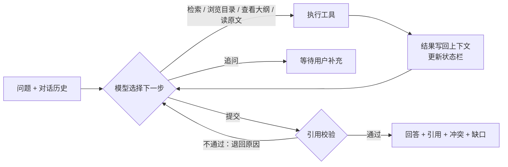

# 企业知识问答 Agent

一个帮助员工查询公司制度和产品问题的问答 Agent。它不直接拿检索结果拼答案，而是像查资料的人一样，自己决定下一步：先检索，结果不理想就换关键词或按目录翻找，读到原文后再回答。每个结论都附上文档出处和原文片段。

遇到两份制度说法不一致时，它会先核查版本、适用范围和替代关系：能查清就按现行制度回答，查不清就把冲突摆出来请你确认，**不会自作主张选一个答案**。

> 本项目是小影科技 2027 校招 AI Agent 笔试的提交作品（第 3 题：企业知识问答 Agent）。知识库全部为合成数据，“星剪 App”是虚构产品。

## 功能

- **有出处的回答**：引用精确到文档的某个小节，并附逐字原文；系统会校验每条引用是否真实读取过、是否与原文一致，不通过就退回给模型修改。
- **冲突处理**：能区分“可查证的冲突”（如新版制度写明替代旧版）和“无法查证的冲突”（两份现行文件说法不同、又没有优先级说明）。
- **知道自己不知道**：知识库里没有的问题，明确告诉你超出资料范围，不用常识编答案。
- **理解追问**：多轮对话中能理解“那满 10 年呢？”这类指代。
- **工具出错也不慌**：检索服务失败时，模型可以改用目录浏览完成任务；实在无法完成，就如实返回失败，不会把失败说成成功。
- **有边界**：限制模型调用轮数和工具调用次数，超出上限时返回明确的“未完成”状态。
- **抵御注入**：文档中混入“忽略之前的指令”之类的文字时，不会照做。

## 效果示例

问“报销期限多久？”时，知识库中的《费用报销制度》（D01）写 30 天，《报销管理补充通知》（D02）写 15 天，两份都没有说明谁优先。Agent 的实际执行过程（真实模型 `deepseek-flash`，记录见 [C02 执行记录](examples/live/C02-doc-conflict.trace.md)）：

```text
第 1 轮  检索「报销期限」                              → 命中 D01、D02 两份现行文件
第 2 轮  查看 D01、D02 的版本与适用范围（并行）          → 都是现行，范围未注明，互不替代
第 3 轮  阅读原文 D01#s3、D02#s1（并行）                → 30 天 vs 15 天
第 4 轮  阅读 D02 其余条款 · 浏览财务目录（并行）        → 没有找到优先级或废止说明
第 5 轮  提交：资料冲突，需要确认
```

回答节选：

> 知识库中两份现行财务文件对报销提交期限的规定不一致，无法确定唯一答案，需向财务部确认后执行。
> - 《费用报销制度》（D01，2024-03-01，现行）第三条：员工应在费用发生之日起 **30 天**内提交报销申请……
> - 《报销管理补充通知》（D02，2025-01-10，现行）一、提交期限：……应在费用发生后 **15 天**内提交。

把 D02 从知识库中拿掉，再问同一个问题，Agent 读完 D01 就直接回答“30 天”。两次的过程和结论不同，完全是因为它读到的资料不同。

## 工作原理



- **模型决定怎么查**：每一步调用哪个工具、何时结束、以什么状态结束，都由模型决定。代码里没有“检索到两份文档就判冲突”这类写死的规则。
- **代码只负责护栏**：执行工具、限制预算、校验引用。工具失败时代码不自动重试，而是把错误类型和建议交给模型判断。
- **状态栏**：每轮调用前，把剩余预算、已读证据（版本、状态、替代关系）、最近的错误汇总后附在上下文末尾，帮助模型掌握进度。
- **层次型知识库**：按“目录 → 文档大纲 → 小节原文”三层组织，模型既可以关键词检索，也可以像翻文件夹一样逐层查找。

详细设计见 [方案设计](docs/02-solution.md)。

## 快速开始

### 环境要求

- Python 3.10+（开发环境为 3.12.7 / Windows 11）
- DeepSeek API 密钥（只体验离线 Mock 模式时不需要）
- Node.js 20.19+（只有运行前端时才需要）

### 安装与配置

```bash
pip install -r requirements.txt
cp .env.example .env
```

在 `.env` 中填写 `DEEPSEEK_API_KEY`，其他配置项保持默认即可：

| 变量 | 默认值 | 说明 |
|---|---|---|
| `DEEPSEEK_API_KEY` | （必填） | DeepSeek 官方 API 密钥 |
| `DEEPSEEK_BASE_URL` | `https://api.deepseek.com` | 接口地址 |
| `DEEPSEEK_MODEL` | `deepseek-flash` | 模型（DeepSeek-V4.1-Flash） |
| `DEEPSEEK_THINKING` | `enabled` | 是否开启思考模式 |
| `DEEPSEEK_REASONING_EFFORT` | `high` | 思考强度：`low` / `high` / `max` |
| `LLM_TIMEOUT` | `60` | 单次请求超时（秒） |
| `AGENT_MAX_LLM_TURNS` | `8` | 每个问题最多调用模型的轮数 |
| `AGENT_MAX_TOOL_CALLS` | `12` | 每个问题最多调用工具的次数 |

### 命令行提问

```bash
python -m src.main --question "报销期限多久？"
```

执行过程（每一步的动作、返回结果和决策依据）输出到终端，最终结果以 JSON 输出。没有密钥时加上 `--mock` 用离线模式体验流程：

```bash
python -m src.main --question "报销期限多久？" --mock
```

### 网页对话界面

界面类似 ChatGPT / DeepSeek：左侧是对话列表，回答上方可以展开查看检索过程，引用可以点开看原文。

```bash
uvicorn src.server:app --port 8000
```

```bash
cd frontend && npm install && npm run dev
```

然后打开 http://localhost:5173 。

## 命令行用法

```bash
python -m src.main (--question "问题" | --input 用例.json) [选项]
```

| 选项 | 说明 |
|---|---|
| `--question` | 直接提问 |
| `--input` | 从 JSON 文件读取问题（格式见下） |
| `--mock` | 使用离线 Mock 模型，只验证流程，不代表真实模型的效果 |
| `--kb` | 知识库目录，或 `data/kb_variants/` 下的变体名，如 `no_conflict` |
| `--fail` | 模拟工具故障，如 `search:1`（前 1 次失败）、`search:always,browse:always` |
| `--max-llm-turns` / `--max-tool-calls` | 覆盖默认的执行上限 |
| `--output` / `--trace-md` | 把结果 JSON / 执行过程的 Markdown 表格写入文件 |
| `--quiet` | 不在终端打印执行过程 |

输入文件格式（`history` 和 `options` 可选；`expect` 只供评测脚本使用）：

```json
{
  "question": "那满 10 年呢？",
  "history": [{"question": "我入职 3 年了，年假有几天？", "answer": "7 天", "citations": [{"doc_id": "D07", "section_id": "s1"}]}],
  "options": {"kb": "no_conflict", "fail": "search:1", "max_llm_turns": 8}
}
```

结果中的 `status` 表示任务状态：

| 状态 | 含义 |
|---|---|
| `answered` | 已回答，并有校验通过的引用 |
| `conflict_needs_confirmation` | 资料冲突且无法查证优先级，请用户确认 |
| `need_clarification` | 需要用户补充信息 |
| `out_of_scope` | 知识库中没有相关资料 |
| `tool_error` | 工具故障，无法完成 |
| `incomplete` | 达到执行上限，未完成 |
| `model_error` | 模型接口不可用 |
| `cancelled` | 用户在网页上点击了“停止” |

业务结果（包括失败和未完成）的退出码都是 0；输入文件或知识库不合法时，退出码为 2。

## 知识库

```text
data/kb/
├── 制度/
│   ├── 财务/   D01 费用报销制度、D02 报销管理补充通知
│   ├── 人事/   D03 年假制度（2023 版，已废止）、D07 年假制度（2025 版）、D05 远程办公制度
│   └── 行政/   D06 办公设备申领规定
└── 产品/星剪App/   D04 常见问题、D08 使用技巧（含一段模拟的注入文本）
```

每篇文档是一个 Markdown 文件：开头的元数据写明文档编号、版本日期、状态（现行/已废止）、适用范围和替代关系，正文按 `##` 分成小节。每个目录下的 `_dir.md` 提供该目录的一句话摘要。

**新增文档**：本项目不包含 PDF/Word 解析，需要按下面的模板手写 Markdown，放进对应目录，然后运行校验：

```markdown
---
doc_id: D09                  # 唯一，形如 D01
title: 文档标题
version_date: 2026-01-01     # YYYY-MM-DD
status: 现行                  # 现行 / 已废止
scope: 适用范围（没有就写“未注明”）
supersedes: []               # 本文替代了哪些文档
superseded_by: null          # 被哪篇替代（必须与对方的 supersedes 对应）
links: []                    # 相关文档
abstract: 一句话摘要
---
## 第一条 小节标题
小节原文……
```

```bash
python -m src.kb.check
```

校验内容包括：必填字段、编号唯一、日期格式、替代关系双向一致、链接没有指向不存在的文档。知识库在每次启动时从这些文件直接构建，修改后下次运行即生效。

## 测试与评估

```bash
python -m pytest -q                        # 57 个自动化测试，不调用模型
python scripts/run_eval.py --mode live     # 用真实模型运行全部 11 个用例并自动判定
python scripts/run_eval.py --mode mock     # 离线 Mock 运行全部用例
python scripts/stability.py                # 关键用例重复运行 3 次
```

| 项目 | 结果 |
|---|---|
| 真实模型（`deepseek-flash`）验收用例 | 11/11 通过（[报告](examples/live/report.md)） |
| 关键用例稳定性复跑（C02、C04、C10 各 3 次） | 9/9 通过（[报告](examples/live/stability/report.md)） |
| 自动化测试 | 57/57 通过（[记录](examples/test-results.txt)） |
| 离线 Mock | 8 个通过，3 个属于 Mock 本身的已知局限（[报告](examples/mock/report.md)） |

用例与题目验收点的对应关系：

| 验收点 | 用例 | 真实模型的表现 |
|---|---|---|
| 明确答案 | C01、C08 | 引用远程办公制度、报销制度回答 |
| 文档冲突 | C02、C09 | 报销期限冲突时请求确认；年假新旧版本冲突时查到替代关系，按 2025 版回答 |
| 资料外问题 | C03 | 返回超出资料范围 |
| 改写后的相似问题 | C04 | 换了说法也能改写检索词，结论与 C02 一致 |
| 上下文追问 | C05 | 结合上一轮回答“满 10 年 12 天” |
| 工具失败 | C06a、C06b | 检索失败时改用目录浏览完成；全部工具失败时如实返回失败 |
| 执行上限 / 替换文档 / 注入 | C07、C08、C10 | 返回未完成 / 答案随知识库改变 / 不执行注入指令 |

每个用例的输入、真实输出和逐步执行记录都在 `examples/` 下。评估过程中发现的问题（包括评测断言本身写错的两次）见 [测试与评估](docs/03-evaluation.md)。

## 项目结构

```text
.
├── src/
│   ├── main.py          命令行入口
│   ├── server.py        HTTP 接口（逐步推送执行过程，支持停止）
│   ├── agent/           主循环、状态栏、引用校验、提示词、执行记录
│   ├── tools/           工具定义、故障模拟
│   ├── kb/              知识库加载、校验与检索
│   └── llm/             DeepSeek 接入、离线 Mock 模型
├── frontend/            网页对话界面（React）
├── data/                合成知识库与变体库
├── examples/            用例输入、真实与 Mock 运行结果、评测报告
├── scripts/             批量评测、稳定性复跑
├── tests/               自动化测试
└── docs/                需求、方案、评估、AI 使用说明、复盘
```

## 技术选型

| 部分 | 选择 | 原因 |
|---|---|---|
| 模型 | DeepSeek 官方接口 `deepseek-flash`，开启思考模式 | 支持工具调用和严格参数校验，成本低 |
| Agent 框架 | 不使用框架，自己实现主循环 | 每一步决策都可见、可测试，便于解释 |
| 检索 | jieba 分词 + BM25 关键词检索，加目录浏览 | 本题的难点是冲突和版本，而不是语义召回；没有采用向量检索（Milvus + embedding），因为部署太重、复现门槛高，在 8 篇文档的规模下收益也很小 |
| 接口 | FastAPI + SSE | 让网页实时显示每一步 |
| 前端 | React 19 + TypeScript + react-router + zustand + Vite | 对话界面，对话记录保存在浏览器本地 |

## 已知限制

- 引用校验只检查引用本身是否真实，不检查回答中的每一句话都有出处；模型偶尔会补充一句资料里没有的推断。
- 关键词检索不理解同义词，需要模型改写检索词或改用目录浏览来弥补。
- 每个问题大约需要 10–25 秒、1–2.5 万 token；模型倾向于多查几步再回答。
- 不包含原始文档导入（PDF/Word 解析）、权限控制和会话的服务端持久化。

更多见 [复盘](docs/05-retrospective.md)。

## 文档

| 文档 | 内容 |
|---|---|
| [需求说明](docs/01-requirements.md) | 用户、目标、范围和成功标准 |
| [方案设计](docs/02-solution.md) | 调用流程、动态决策、技术取舍 |
| [测试与评估](docs/03-evaluation.md) | 测试预期、实际结果、失败和限制 |
| [AI 使用说明](docs/04-ai-usage.md) | AI 辅助的内容、个人修改及验证 |
| [复盘](docs/05-retrospective.md) | 最难的问题、学习收获、下一步 |
