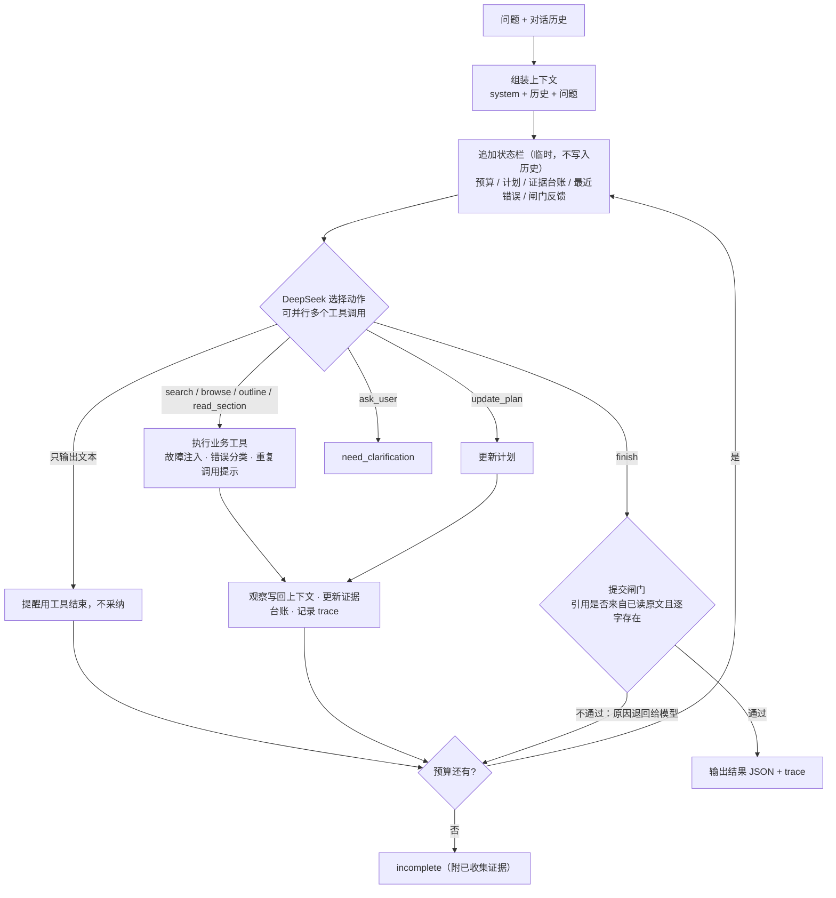

# 02 方案设计

## 调用流程



### 一个真实例子（C02，`examples/live/C02-doc-conflict.trace.md`）

`search("报销期限")` 与 `browse(制度/财务)` 并行，找到 D01、D02 两份现行文档 → 模型并行调用 `outline(D01)`、`outline(D02)`，查看两份文档的状态、范围和替代关系（都是现行、范围未注明、互不替代）→ 读取 D01#s3（30 天）、D02#s1（15 天）→ 再读 D02 的其余条款，确认没有“以本通知为准”之类的优先级说明 → `finish(conflict_needs_confirmation)`：列出两份原文，在 gaps 中写明查证后仍缺的 3 条信息，请用户确认适用哪份文件。对照 C08（换成去掉 D02 的知识库），同一个问题读到 D01 后直接 `answered`：30 天。**两条路径的差别，完全来自工具返回的内容不同。**

## 动态决策：哪些由模型决定，哪些由代码负责

| 由模型决定（在 trace 的 reason 字段中可见） | 由代码负责（不做业务判断） |
|---|---|
| 用什么关键词检索；结果不好时改写查询还是改用目录浏览 | 执行工具；把异常转成带 `retryable` 和 `suggestion` 的观察结果 |
| 读哪几个小节；是否用 `outline` 查证版本、范围、替代关系 | 预算：最多 8 轮模型调用、12 次业务工具调用（可配置） |
| 判断冲突能否查证：回答 / 列出冲突 / 追问 | 提交闸门：校验引用真实性，不判断答案对错 |
| 工具失败后：重试、换工具还是停止 | 状态栏渲染、重复调用提示、trace 记录 |
| 何时结束、以什么状态结束 | 达到上限时返回 `incomplete` |

代码里**没有**“检索到两份文档就判冲突”“失败就重试”这类业务分支：工具失败后代码不自动重试，`finish` 的状态完全由模型选择。闸门只检查证据是否成立。

## 关键设计

| 设计 | 作用 |
|---|---|
| **状态栏**：每轮调用模型前，把预算、计划、证据台账（已读小节的版本、状态、范围、替代关系）、最近错误作为临时 user 消息追加在末尾 | 让模型随时看到“我已经知道什么、还剩多少预算”，减少重复调用和死循环；不写入历史，因此不会随轮数累积 |
| **检索工具化 + 多轮迭代** | 检索由模型主动调用，不是固定的前置步骤，可以改写查询、补充检索 |
| **层次型知识库（文件系统范式）**：目录（L0 摘要）→ 文档大纲（L1 元数据）→ 小节原文（L2） | 关键词检索失效（改写问题、检索故障）时，可以按目录导航；版本和替代关系是一等公民 |
| **路径前缀索引**：每个小节以 “目录 文档ID 标题 小节标题” 作为前缀参与 BM25 | 正文没有出现的上下文（如“人事”）也能被检索到 |
| **指令与数据分离**：提示词声明工具返回的内容是资料不是指令；状态栏也标明“不是资料” | 防御文档中的注入文本（C10） |
| **提交闸门**（全部为确定性检查）：① 引用的小节必须是本次 `read_section` 读过的，quote 必须逐字出现在原文中（只容忍首尾和连续空白的差别）；② 状态与引用相符：`answered` 不能只依据已废止文档；冲突状态需要至少两份文档的引用、冲突描述（涉及的文档必须已引用）和非空 gaps；`out_of_scope` / `tool_error` 不能携带引用；③ 答案中的业务数值（含中文数字，如“六十天”）必须出现在所引用的原文中，用户问题里的数值不算依据；④ 条件与数值对应：紧挨在数值前的条件（满 / 不满 / 超过 / 至少 + 数值）与该数值成对，原文中必须有同样的配对，“满 10 年有 7 天”会被拒 | 杜绝“错误引用”和“引文真实但与结论不符”；不通过时把原因退回给模型修正（最多 2 次）。③④ 只覆盖数值和“条件 + 数值”模式，没有单位的裸数字和更一般的语义支撑无法机械判断，留给后续的异源模型评审 |

## 技术取舍

| 选择 | 理由 | 代价 |
|---|---|---|
| 原生 harness，不用 LangGraph / ADK | 题目考察的是决策循环本身；自己实现时每一步都可见、可测（ScriptedLLM 能精确驱动每一轮）；约 300 行 | 没有框架自带的持久化、断点续跑 |
| DeepSeek 官方 `deepseek-flash` + 思考模式 | 支持 function calling 和 strict schema；思考模式提升查证质量。注意：带 tools 的请求必须原样回传 `reasoning_content`，否则 400。harness 把整条 assistant 消息追加回上下文 | 每题约 10–25 秒，约 1–2 万输入 token |
| strict 工具调用（`/beta` 端点） | 参数结构由服务端校验，减少参数缺失 | 仍可能出现非法 JSON（C05 出现过一次），harness 把它作为观察退回，模型下一轮重发 |
| 对话历史以文本放进 user 消息 | 避免伪造不含 `reasoning_content` 的 assistant 历史消息 | 历史中不保留上一轮的工具细节，只保留答案和引用 ID |
| **默认不启用向量检索（Milvus + embedding）** | ① 太重：评审需要部署 Milvus 并另外申请 embedding 密钥，复现门槛高；② 8 篇文档的规模下召回收益很小；③ 本题难点是冲突与版本，依赖结构化元数据而不是语义相似度；④ 改写问题由模型改写查询或目录导航解决。向量与混合检索已作为可插拔选项实现（见下文“可扩展性”），默认仍是 BM25 | 默认模式下同义词召回依赖模型改写 |
| 启动时从 Markdown 构建索引，不持久化 | 修改文档后下次运行即生效（审核要点“替换文档内容”零成本）；同时做强校验 | 大规模知识库时启动慢，需要增量索引 |
| CLI 为主入口，HTTP + 前端为演示 | 一条命令即可复现；前端按 ChatGPT / DeepSeek 的对话形态做，功能保持精简：对话列表、可折叠的检索过程、Markdown 回答、引用卡片、停止 | 没有知识库编辑、重新生成、主题切换；变体库与故障注入只在 CLI 中演示 |

## 模块

| 模块 | 文件 | 职责 |
|---|---|---|
| 主循环 | `src/agent/harness.py` | 上下文组装、模型调用、工具分发、预算、终止 |
| 状态栏 | `src/agent/status_bar.py` | 渲染动态状态 |
| 提交闸门 | `src/agent/gate.py` | 引用校验 |
| 轨迹 | `src/agent/trace.py` | 返回摘要、后续动作、Markdown 渲染 |
| 工具 | `src/tools/registry.py`、`plugin.py`、`plugins/`、`faults.py` | 3 个核心工具（计划、追问、提交）+ 插件业务工具；schema 自动生成、热加载、错误转换、故障注入 |
| 知识库 | `src/kb/store.py`、`retrievers/` | 加载、校验（必填字段、ID 唯一、替代关系双向一致、链接无死链、日期格式）、L0/L1/L2；检索器可插拔（BM25 / 向量 / 混合） |
| 模型 | `src/llm/providers.py`、`openai_compat.py`、`mock.py` | 提供方配置 + 通用 OpenAI 兼容适配器；离线 MockLLM（规则）；ScriptedLLM（测试） |
| 入口 | `src/main.py`、`src/server.py`、`frontend/` | CLI；FastAPI SSE（客户端断开时通过 should_stop 取消）；React 对话界面 |
| 评测 | `src/evaluation.py`、`scripts/run_eval.py`、`stability.py`、`replay_gate.py` | 用例断言；批量评测；稳定性复跑；用当前闸门离线回放历史输出 |

## 知识库格式与新增文档

```text
data/kb/
├── 制度/
│   ├── 财务/   D01 费用报销制度、D02 报销管理补充通知
│   ├── 人事/   D03 年假制度（2023 版，已废止）、D07 年假制度（2025 版）、D05 远程办公制度
│   └── 行政/   D06 办公设备申领规定
└── 产品/星剪App/   D04 常见问题、D08 使用技巧（含一段模拟的注入文本）
```

每篇文档是一个 Markdown 文件：开头的元数据写明文档编号、版本日期、状态（现行/已废止）、适用范围和替代关系，正文按 `##` 分成小节；每个目录下的 `_dir.md` 提供该目录的一句话摘要（L0）与概览（L1）。

知识导入默认已经完成：本项目不解析 PDF/Word，也不自动生成摘要。新增文档时按下面的模板手写，放进对应目录后运行 `python -m src.kb.check` 校验（必填字段、编号唯一、日期格式、替代关系双向一致、链接无死链）。知识库在每次启动时直接从这些文件构建，修改后下次运行即生效。

```markdown
---
doc_id: D09                  # 唯一，形如 D01
title: 文档标题
version_date: 2026-01-01     # YYYY-MM-DD
status: 现行                  # 现行 / 已废止
scope: 适用范围（没有就写“未注明”）
supersedes: []               # 本文替代了哪些文档
superseded_by: null          # 被哪篇替代（必须与对方的 supersedes 对应）
links: []                    # 相关文档
abstract: 一句话摘要
---
## 第一条 小节标题
小节原文……
```

## 可扩展性

三类常见的扩展都不需要改动 harness 主循环。

### 检索可插拔（`src/kb/retrievers/`）

```
Retriever 协议：index(items) / search(query, top_k)
├── BM25Retriever                    默认；jieba + BM25
├── VectorRetriever(Embedder, VectorStore)
│     Embedder：OpenAICompatEmbedder（硅基流动 bge-m3，按内容哈希缓存到磁盘）| HashEmbedder（离线，无语义）
│     VectorStore：MemoryVectorStore（默认）| MilvusVectorStore（pymilvus MilvusClient，COSINE）
└── HybridRetriever                  多路结果按排名 RRF 融合：Σ 1/(k + rank)，不受各路分数量纲影响
```

- 由 `RETRIEVER` / `EMBEDDING_PROVIDER` / `VECTOR_STORE` 配置选择，CLI 也可以用 `--retriever` 指定。没有 embedding 密钥时设置 `EMBEDDING_PROVIDER=hash` 可离线跑通流程（哈希向量无语义）；Milvus 需要 `pip install pymilvus` 并设置 `MILVUS_URI`。
- 新增一种检索方式：实现 `index()` 与 `search()`，在 `retrievers/registry.py` 的 `create_retriever` 中注册。
- 后端故障（embedding 服务、Milvus 不可用）统一抛出 `RetrieverError`，工具层转成可重试的 `RetrieverUnavailable` 交给模型，由模型决定重试还是改用目录浏览，和工具失败的处理方式一致。
- 选 RRF 而不是加权分数：BM25 分数与余弦相似度量纲不同，按排名融合不需要调权重。

### 多模型适配（`src/llm/providers.py`、`openai_compat.py`）

各家 OpenAI 兼容接口的差异集中在 `ProviderProfile` 中，`OpenAICompatClient` 按配置组装请求：

| 差异 | DeepSeek | Qwen 系（硅基流动 / 百炼） | Moonshot | OpenAI |
|---|---|---|---|---|
| 思考模式开关 | `extra_body.thinking` | `extra_body.enable_thinking` | 无 | 无 |
| 多轮回传 `reasoning_content` | 必须（否则 400） | 不需要，发送前去掉 | 不需要 | 不需要 |
| strict 工具参数校验 | 支持（`/beta` 端点） | 不支持，发送前去掉 `strict` | 不支持 | 支持 |
| `reasoning_effort` | 支持 | 不发送 | 不发送 | 不发送 |

切换方式：`LLM_PROVIDER` 环境变量或 CLI `--provider` / `--model`。只有 DeepSeek 用真实密钥跑通过评测；其他提供方按各自的接口文档配置，由单元测试检查请求参数（`tests/test_providers.py`）。新增一家 OpenAI 兼容服务，只需要在 `PROVIDERS` 中加一条配置。

### 工具插件与热加载（`src/tools/plugin.py`、`plugins/`）

- **核心工具与业务工具分开**：`update_plan`、`ask_user`、`finish` 与主循环的结束逻辑和提交闸门绑定，留在代码里；检索、浏览、大纲、读原文这类“参数 → JSON”的业务工具放到插件目录。
- **schema 自动生成**：`@tool` 装饰器读取函数的类型注解（`str` / `int` / `float` / `bool` / `list` / `Literal`，`Annotated[类型, "说明"]` 写参数说明），生成满足 strict 要求的 JSON Schema。`reason` 是保留参数名。
- **热加载**：`PluginRegistry.refresh()` 比较插件目录中文件的名称、修改时间和大小，有变化才重新加载整个目录。CLI 每次运行加载一次；HTTP 服务在每个请求开始时 refresh，修改插件无需重启。
- **错误隔离**：某个文件语法错误、工具名重复或定义不合法，只会让这个文件不可用，原因记录在 `load_errors` 中（`GET /api/tools`）；插件运行时抛出的异常被包装成 `PluginError` 观察结果交给模型，不会打断主循环。
- **写法示例**：

  ```python
  # src/tools/plugins/doc_count.py
  from typing import Annotated
  from src.tools.plugin import ToolContext, tool

  @tool(description="统计某种状态的文档数量")
  def doc_count(ctx: ToolContext, status: Annotated[str, "现行 / 已废止"]) -> dict:
      return {"count": sum(d.status == status for d in ctx.kb.docs.values())}
  ```
- **证据不能伪造**：harness 按返回内容的形状更新证据台账（不再按工具名判断），但只有当插件返回的原文与知识库中对应小节的原文完全一致时，才会记入台账、允许被引用。

## 依赖与版本

openai 2.x（OpenAI 兼容协议调用模型与 embedding）、pymilvus（可选，仅 Milvus 向量存储）、jieba 0.42（分词）、PyYAML（front matter）、python-dotenv、FastAPI 0.128 + uvicorn（演示 API）、pytest 7.4；前端 React 19 + TypeScript + react-router 7 + zustand 5（对话持久化到 localStorage）+ react-markdown（不渲染原始 HTML）+ Vite 8。没有使用任何 Agent 框架。
